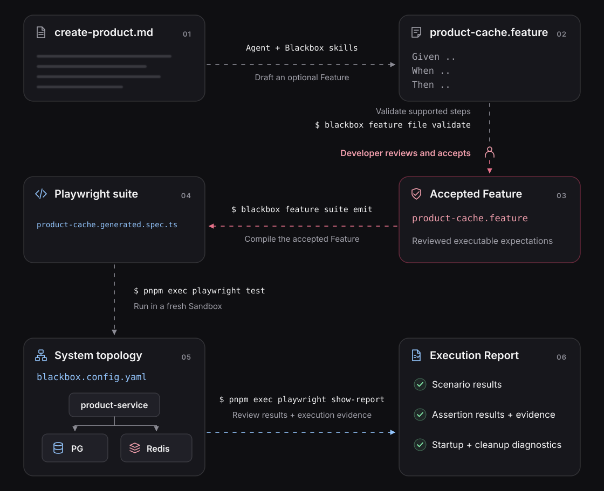
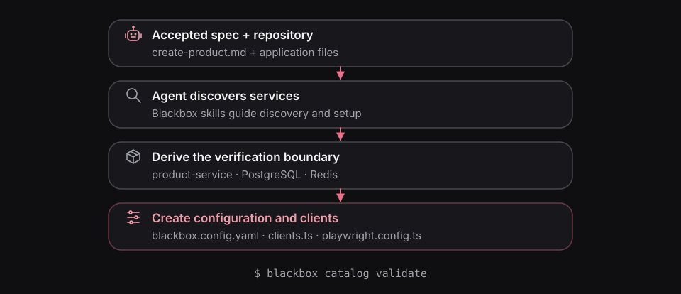
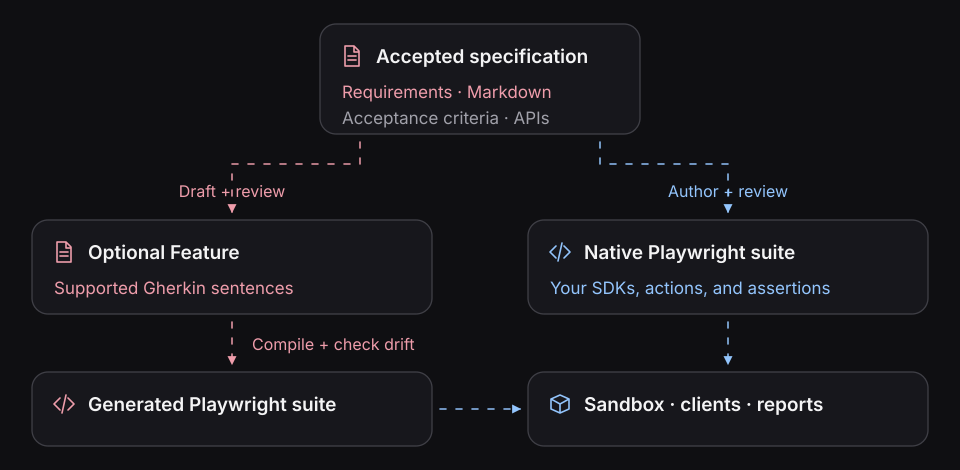

<p align="center">
  
</p>

<div align="center">
  <a href="https://opensource.org/licenses/Apache-2.0"></a>
  <a href="https://github.com/suites-dev/suites/blob/master/CONTRIBUTING.md"></a>
</div>

<h1 align="center">Suites / Blackbox</h1>

**A system testing framework for executable specifications and runtime verification, built for developers and coding
agents.**

<p align="center">
  <a href="docs/README.md">Docs</a> ·
  <a href="#installation-and-agent-onboarding">Installation</a> ·
  <a href="#quickstart">Quickstart</a> ·
  <a href="docs/guides/README.md">Guides</a>
</p>

Blackbox turns accepted specs into verification against real applications and systems.
Its skills and CLI help coding agents execute specified behavior, inspect what happened, investigate failures,
repair the implementation, and rerun against the same accepted expectations.

Express expected behavior in native Playwright tests or optional executable Feature files that generate a suite.
Each test runs the selected application and dependencies in a fresh isolated Sandbox, checking responses, state,
and runtime evidence against the spec.

## Blackbox and Spec-Driven Verification

**Spec-Driven Verification checks a running system against an accepted spec.**

The source can be product requirements, acceptance criteria, an OpenAPI contract, Markdown, or any agreed behavior.
The figure follows a Markdown spec through the optional Feature-file path to execution and reporting.

<p align="center">
  
</p>

The CLI drives validation, test generation, and investigation. Blackbox's skills guide the agent through these
commands and their structured feedback, from accepted spec to execution evidence.

### Specs and Behavioural Contracts

**Specifications in any format can become stale as implementation evolves.**

Blackbox solves this by introducing **Behavioural Contracts** into the verification loop. A behavioural contract
expresses accepted requirements as executable expectations about responses, state changes, and runtime interactions.
Tests preserve the contract alongside code. Reviewed effects snapshots record expected runtime interactions for
comparison with later runs. Together, they keep accepted expectations in the verification loop:

- **Review** checks that executable expectations express the accepted spec.
- **Behavioural Contracts** preserve the intended behavior as the implementation changes.
- **Execution** makes departures from that behavior visible.

Tests enter the running system through I/O, such as HTTP endpoints or asynchronous messages, and check its observable
behavior. Internal code can change while the same behavioural contract remains the basis for verification.

Product creation requires a successful response, persistence in PostgreSQL, and population of Redis.
This **single scenario** separates response, effects, and state assertions. It assumes an empty store, configured system,
[clients](docs/playwright/clients-and-fixtures.md), and an [effects evaluator](docs/playwright/clients-and-fixtures.md#inspect-the-attempt).

```ts
import { expect, test } from '@suites/blackbox-playwright';
import { db, redis } from './clients.js';

test.system('product-system', (system) => {
  // Prepare a fresh Sandbox and connect its clients for each test.
  system.sandbox('default', { clients: { db, redis } }, (suite) => {
    suite.describe('Feature: Product creation and retrieval', () => {
      suite.describe('Rule: Persist products and serve valid cache entries', () => {
        suite.test('Scenario: Create a product', async ({ clients, effects, request, sandbox }) => {
          const product = { id: 'product-1', name: 'Field notebook', priceCents: 1299 };
          const key = `product:${product.id}`;
          const url = new URL('/products', sandbox.entrypoint.url).href;
          const response = await test.step('When the product is created', () =>
            request.post(url, { data: product }));

          await test.step('Then return the created product', async () => {
            expect(response.status()).toBe(201);
            expect(await response.json()).toMatchObject(product);
          });

          await test.step('And write the product to the cache', async () => {
            // Effects check the application's runtime interactions.
            await expect(effects).toSatisfy((e) => [
              e.exists(e.cache({ actor: 'product-service', operation: 'SET', target: key })),
            ]);
          });

          await test.step('And persist the product and populate its cache', async () => {
            // Clients inspect state in real dependencies.
            const stored = await clients.db.query(
              'SELECT id, name, price_cents AS "priceCents" FROM products WHERE id = $1',
              [product.id],
            );
            expect(stored.rows).toEqual([product]);
            const cached = await clients.redis.get(key);
            expect(cached).not.toBeNull();
            expect(JSON.parse(cached!)).toEqual(product);
          });
        });
      });
    });
  });
});
```

The response shows what the caller received; effects check runtime interactions; native clients inspect stored state.
Together, these assertions express the [behavioural contract](docs/contracts/README.md).

Blackbox fits spec-driven development (SDD) workflows such as Spec Kit, Kiro, and OpenSpec, connecting their accepted
specifications to executable checks and runtime evidence.
[Specifications and SDD workflows](docs/integrations/README.md).

## Quickstart

Give your agent the specification. It proposes expectations for your review, prepares the application and
dependencies, and authors or generates native Playwright tests.

Playwright runs them in fresh Sandboxes and produces an HTML report with results and Blackbox runtime evidence.
The agent uses the CLI to investigate failures, then repairs and reruns against the same accepted expectations.

Start with one requirement: creating a product must persist it in PostgreSQL and populate Redis;
retrieving a valid cached product must avoid a PostgreSQL read. Follow the [full guide](docs/guides/verify-a-specification.md).

### Installation and Agent Onboarding

Ask your coding agent to start onboarding in your repository:

```sh
npx @suites/blackbox-cli onboarding start
```

The onboarding prompt guides the agent through installing packages and preparing your repository.

Blackbox provides a full skill system for setup, execution, investigation, and verification. The skills supply
procedures and context; the CLI supplies commands and structured feedback the agent uses to carry out each step.

The agent discovers services and dependencies, derives the system topology, and identifies application and subsystem
boundaries. It creates or updates Blackbox configuration and supporting files, including client definitions.
Follow the [setup guide](docs/playwright/connect-your-application.md) for the full process.

<p align="center">
  
  <br />
  <sub>The agent derives runnable boundaries from the repository’s services and dependencies.</sub>
</p>

### From specification to executable tests

The authoring skills help the agent translate the accepted rule into concrete tests.
**You keep ownership of the expected behavior:** review the expectations before using them to judge an implementation.

<p align="center">
  
</p>

**Option A: a Feature file.** Blackbox adopts Gherkin from Cucumber for its readable
`Feature → Rule → Scenario` structure. The CLI validates supported HTTP steps and compiles them to native Playwright.
This excerpt checks creation; the [full Feature](docs/features/drafting-feature-files.md) also checks cached retrieval.

```gherkin
@system:product-system @sandbox:default
Feature: Product creation and retrieval
  Rule: Persist products and serve valid cache entries
    Scenario: Create a product
      Given client "api" GET "/fixture/products/product-1" returns 200 with JSON exactly:
        """json
        { "postgres": null, "redis": null }
        """
      When client "api" sends POST "/products" with JSON:
        """json
        { "id": "product-1", "name": "Field notebook", "priceCents": 1299 }
        """
      Then the response status is 201
      And the response JSON contains:
        """json
        { "id": "product-1", "name": "Field notebook", "priceCents": 1299 }
        """
      And client "api" GET "/fixture/products/product-1" returns 200 with JSON exactly:
        """json
        {
          "postgres": { "id": "product-1", "name": "Field notebook", "priceCents": 1299 },
          "redis": { "id": "product-1", "name": "Field notebook", "priceCents": 1299 }
        }
        """
```

**Option B: native Playwright.** Use SDK clients and ordinary assertions, as in the
[creation example above](#specs-and-behavioural-contracts), preserving `Feature → Rule → Scenario` nesting
and **Arrange → Act → Assert**.

The Feature reads state through an **example-owned** `/fixture/` HTTP route. Native tests can inspect
state through SDK clients and assert runtime effects. The [full walkthrough](docs/guides/verify-a-specification.md#native-playwright)
adds cached retrieval.

Generated suites preserve the Feature's structure and stay unedited. Native suites are project-owned.
Playwright runs both in Blackbox Sandboxes; the [reporting guide](docs/guides/reports.md) explains results and evidence.

## Keep the spec connected as code changes

**Review** checks that tests express the spec. **CLI validation** checks that generated TypeScript still matches
its Feature. **Execution** checks the running implementation against the accepted assertions and effects.

The skills guide the agent to preserve those expectations during local iteration and CI. When intended behavior
changes, review the spec, tests, and effects baseline together. A failed run should not silently redefine success.

A passing test supports the assertions that ran under the observed conditions. Runtime observations, including
OpenTelemetry, answer questions beyond the response. The requirement determines which evidence each test needs.

[Spec-Driven Verification](docs/concepts/spec-driven-verification.md) ·
[Evidence](docs/concepts/behavioral-evidence.md) · [CI verification](docs/guides/ci-verification.md)

---

[All docs](docs/README.md) · [Contributing](CONTRIBUTING.md) · [License](LICENSE)
