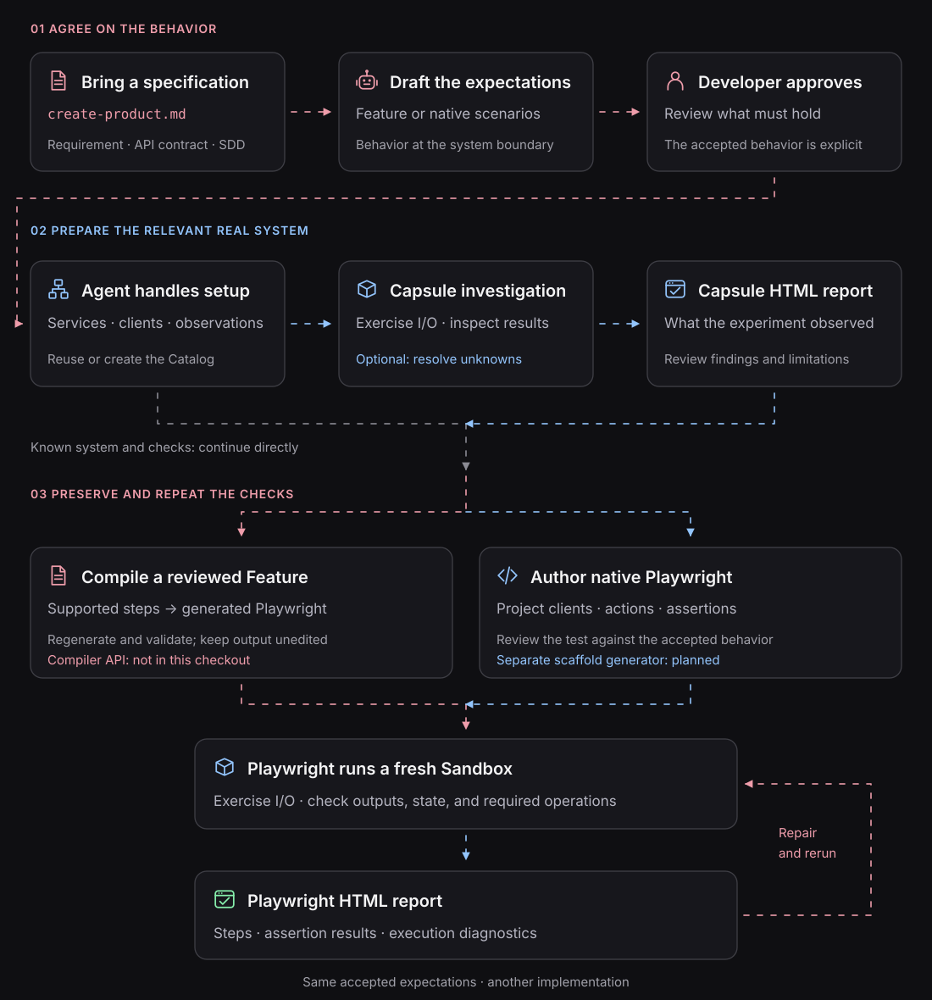

<p align="center">
  
</p>

<h1 align="center">Suites / Blackbox</h1>

**Spec-Driven Verification for agentic software engineering.**

Blackbox is a **verification framework for people building with coding agents**. Start with the
behavior you agreed on. Let your agent prepare the real system, exercise it through its interfaces,
and check what it returns, changes, and does.

**Keep the accepted behavior alongside the code. Verify it again when the implementation changes.**

[Give your agent a specification](#give-your-agent-a-specification) ·
[Developer walkthrough](docs/guides/from-spec-to-verification.md) · [Docs](docs/README.md)

## Why Blackbox?

**The application runs its implementation. The test interacts with the application.** Tests enter
through I/O, such as the HTTP API, rather than importing `ProductService` and calling its methods.
They exercise the real participants needed for the behavior, then inspect outputs, state, and
relevant runtime interactions.

That boundary gives Blackbox its name. An agent can reorganize classes or replace an ORM while the
same expectations remain useful. Client bindings and observers may still need maintenance; changing
that machinery is different from changing what counts as correct behavior.

You may already call these integration tests. Blackbox supplies the CLI, agent skills, isolated
execution, investigation, and reporting workflow to repeat them against an accepted specification.
[Why the boundary matters](docs/concepts/spec-driven-verification.md#why-the-testing-boundary-matters).

## One rule, verified against the running system

> Creating a product persists it in PostgreSQL and populates Redis. A valid cached retrieval returns
> that product without reading PostgreSQL.

A cache bypass can return the right product and still violate the rule. Check the response, the
stored values, and the application's database/cache operations:

<p align="center">
  
</p>

**Collected results are evidence. Accepted expectations are the behavioral contract.** The spec
selects what matters; a trace can explain a failure without every internal span becoming a promise.
[How this example checks its evidence](docs/concepts/behavioral-evidence.md).

## Keep the contract with the test

The planned effects-snapshot workflow brings related artifacts together:

```text
create-payment.feature            reviewed scenarios; optional
create-payment.blackbox.test.ts    setup, actions, output and state assertions
create-payment.effects.yaml       accepted runtime interactions; planned
```

The names illustrate the proposed layout, not a released discovery convention or a payment sample.
A separate `create-payment.state.yaml` is still being discussed; state assertions stay in TypeScript
for now. The source specification remains authoritative.

<picture>
  <source media="(max-width: 640px)" srcset="docs/assets/contracts/behavioral-contract-mobile.svg" />
  
</picture>

An effects snapshot would preserve **selected, reviewed runtime behavior**, not every raw
OpenTelemetry span. Capture may be automatic; accepting a baseline must be deliberate. The schema,
commands, scenario association, and default capture/opt-out policy belong to the upcoming
implementation, not this documentation change.

[Behavioral contracts](docs/contracts/README.md) · [Effects snapshots](docs/contracts/effects-snapshots.md)

## From specification to repeatable verification

Agree on the behavior. Reuse or prepare the smallest sufficient system. Investigate unknowns in a
Capsule when needed. Keep the checks and, with the planned snapshot support, review candidate effects
before accepting a baseline. Then verify the contract in a fresh Playwright Sandbox.

<p align="center">
  
</p>

Capsule is the laboratory; Playwright is repeatable verification. They are separate executions.
The new snapshot review step extends this workflow—it does not make a successful experiment an
automatically accepted test result.

[Full workflow](docs/guides/from-spec-to-verification.md) · [Review baseline changes](docs/contracts/reviewing-changes.md)

## Give your agent a specification

With compatible packages installed, let the agent use Blackbox's operational skills:

```sh
pnpm exec blackbox skills install blackbox --codex
pnpm exec blackbox skills install discovery --codex
pnpm exec blackbox skills install catalog --codex
pnpm exec blackbox skills install capsule --codex
```

Choose the host option for your agent, then give it the accepted requirement:

```text
Use Suites Blackbox to verify this specification.
Draft scenarios for my approval, then reuse or prepare the relevant real system.
Use a Capsule to investigate unclear actions or observations and show its report.
Create repeatable Playwright checks for the required output, state, and behavior.
If effects snapshot support is installed, propose a baseline for review;
do not accept current behavior automatically or update expectations to hide failure.
Run the checks, show the report and limitations, and repair against the same contract.
Report unavailable capabilities rather than inventing commands.
```

The one-command `npx @suites/blackbox-cli onboarding start` shortcut remains planned.
[Agent setup](docs/playwright/connect-your-application.md).

## Keep the behavior visible in the tests

Gherkin gives reviewers a `Feature → Rule → Scenario` structure. Blackbox's supported vocabulary
supplies executable meaning. The TypeScript, whether generated or authored, performs actions and
checks through the system's interfaces—not private business methods.

This candidate excerpt shows the cache-hit check. Calibration and the initial persisted/cache state
are established by the [complete example](docs/features/drafting-feature-files.md#review-the-feature-rule-and-scenarios):

```gherkin
@system:product-system @sandbox:default
Feature: Product creation and retrieval
  Rule: Persist products and serve valid cache entries
    Scenario: Retrieve a product from its valid cache entry
      # Setup, calibration, response-body check and observation-window start omitted here.
      When client "api" sends GET "/products/product-1"
      Then the response status is 200
      And client "api" GET "/fixture/observations/result" returns 200 with JSON exactly:
        """json
        { "productId": "product-1", "applicationPostgresSelects": 0,
          "applicationPostgresStatements": 0, "applicationPostgresPlans": 0,
          "redisGets": 1, "retrievals": 1 }
        """
```

The `/fixture/` endpoints are sample-owned support for real state and operation measurements. This
is not snapshot syntax: **the current example uses explicit calibrated assertions**. It cannot be
replaced by a missing SQL span or an empty snapshot.

**Compile a Feature:** generated TypeScript stays unedited; validate its alignment with the source.
**Author native Playwright:** use project-owned clients and assertions when richer code is needed.
The separate editable-scaffold generator remains planned. An accepted effects baseline is a separate
expectation artifact in either path, not permission to edit generated tests.

[Native example](docs/guides/verify-a-specification.md#native-playwright) ·
[Feature compilation](docs/features/generating-test-suites.md) · [Editable scaffolds](docs/playwright/editable-scaffolds.md)

## Inspect, repair, verify again

The Capsule report explains an experiment. The Playwright report shows the fresh test attempt,
assertions, and Blackbox diagnostics. Snapshot support should add **accepted versus observed effects
and capture limitations**; that comparison UI is not implemented by this PR.

```sh
# From the candidate e2e/product-cache/ workspace once prerequisites are available
pnpm --dir .. exec playwright test --config product-cache/playwright.config.ts --project native
pnpm --dir .. exec playwright show-report product-cache/playwright-report
```

Keep generated-suite drift separate from runtime effects differences. Normal CI compares the
accepted contract; it should not rewrite baselines to match a failing implementation.
[Reports](docs/guides/reports.md) · [Repair](docs/guides/repair-from-evidence.md) · [CI](docs/guides/ci-verification.md)

Start with one behavior. Reuse the system setup and observations as you bring more of the application
under verification. A passing test supports its executed checks, not the completeness of the spec
or every possible execution.

## Alpha and further guides

The typed clients and Feature compiler from merged [PR #181](https://github.com/suites-dev/blackbox/pull/181)
are not on this docs branch; the product-cache sample is unpublished. Automated drafting, direct
Feature execution inside Capsules, editable-scaffold generation, and effects snapshot comparison
are planned. A state snapshot file is undecided. No new runtime capability or successful end-to-end
run is claimed here.

[Why verification matters now](docs/concepts/why-verification-now.md) · [Docs](docs/README.md) ·
[Contributing](CONTRIBUTING.md) · [License](LICENSE)
