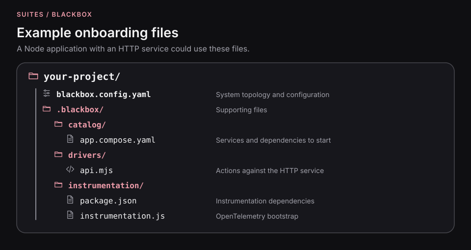
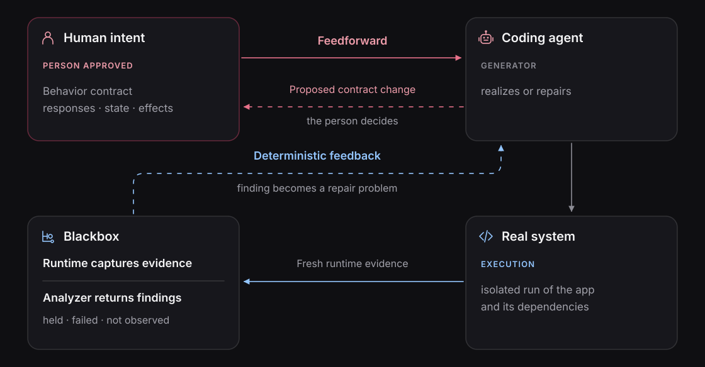
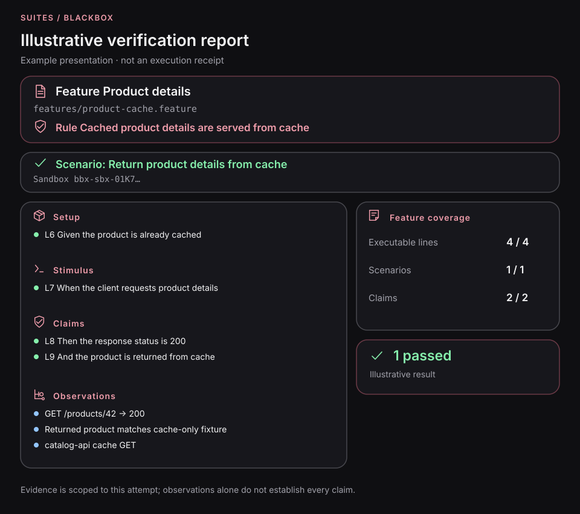
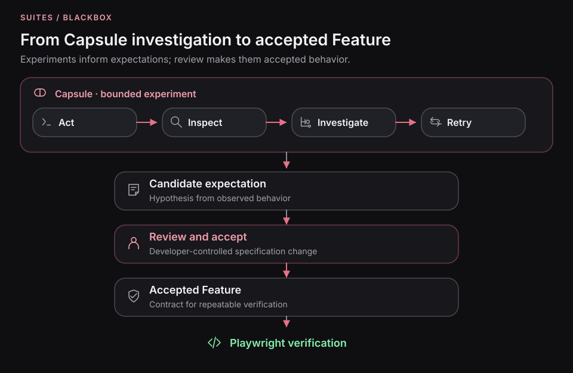
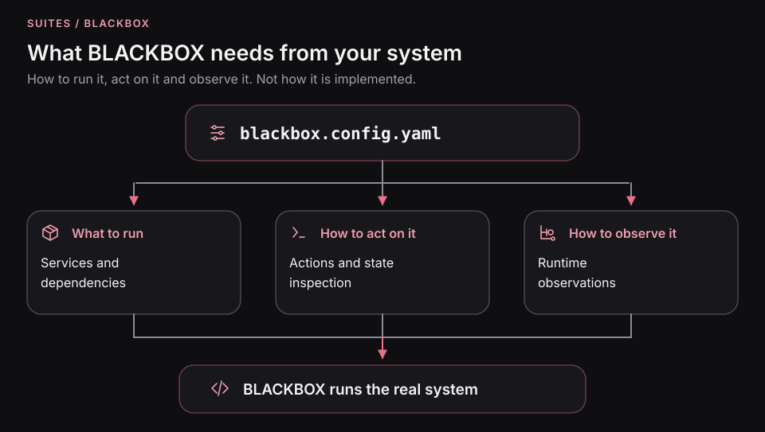

<p align="center">
  
</p>

<h1 align="center">Suites / Blackbox</h1>

**A system testing framework for executable specifications and runtime verification, built for developers and coding
agents.**

Blackbox turns accepted specifications into repeatable verification against real applications and subsystems. Coding
agents can execute the specified behavior, inspect what happened, investigate failures, repair the implementation, and
rerun against the same accepted expectations.

Expected behavior can be expressed directly in native Playwright tests, with a scoped TypeScript Gherkin DSL, or through
optional `.feature` files that compile into a native suite. Each test attempt runs in a fresh isolated Sandbox, using response, state, and runtime
evidence to evaluate the specified claims.

## Spec-Driven Verification

Spec-Driven Verification checks a running system against an accepted specification. That specification can come from
product requirements, acceptance criteria, an API contract (like Swagger and OpenAPI), a Markdown document, or any
other source of agreed behavior.

**Accepted behavior defines the checks; each execution supplies evidence.**

Developers and coding agents turn those requirements into executable expectations for review. They can write native
Playwright tests, use the scoped TypeScript Gherkin DSL, or generate suites from optional Feature files. Blackbox runs the selected application or
subsystem and gathers evidence for the specified claims.

The example below follows the optional Feature-file workflow, from a Markdown specification through review and suite
generation to runtime verification:

<p align="center">
  
</p>

Specifications in any format can become stale as implementation evolves. Blackbox keeps their accepted expectations
in the verification loop: review checks that executable expectations preserve the intended behavior, and repeated
execution makes departures from that behavior visible.

This also fits spec-driven development (SDD) workflows such as Spec Kit, Kiro and Openspec. SDD guides
specification, clarification, planning, and implementation; Blackbox provides executable verification of the accepted
system behavior.

[Spec-Driven workflows integration](docs/integrations/spec-driven-workflows.md)

## Installation - let your coding agent run Blackbox

Ask your coding agent to set up Blackbox in your repository, starting with:

```bash
$ npx @suites/blackbox-cli onboarding start
```

Blackbox provides a full skill system out of the box to let coding agents handle the operational work, from initial
setup to execution, investigation, and verification. The skills provide the procedures and context, while Blackbox’s CLI
returns structured feedback the agent can act on.

### Agent Onboarding

During onboarding, the agent inspects the repository, discovers services and dependencies, and derives the system
topology. It identifies useful application and subsystem boundaries, then creates or updates the Blackbox configuration
and supporting files.

<p align="center">
  
  <br />
  <sub>The agent derives runnable boundaries from the repository’s services and dependencies.</sub>
</p>

The result describes what to run, how to start it, and how to act on and observe it. The agent reuses existing project
files where appropriate. For a Node application with an HTTP service, the setup could look like this:

<p align="center">
  
  <br />
  <sub>Configuration references the files that start, drive, and observe the system.</sub>
</p>

`blackbox.config.yaml` is the configuration authority and references the supporting files. Capsules and Playwright use
that configuration to run the selected system and collect evidence.

[Initial setup](docs/getting-started/agent-onboarding.md) ·
[Agent skills](docs/agents/skills.md)

## Behavior-driven verification

[Behavior-driven development (BDD)](https://cucumber.io/docs/bdd/) uses concrete examples to establish a shared
understanding of expected behavior. Blackbox adopts that approach to verifying real applications and subsystems:
scenarios establish initial conditions, perform an action, and check the required outcomes.

**These specifications describe what the running system must do:** its responses, state changes, and required runtime
effects, such as serving a product from cache. Their meaning should remain stable when classes, functions, or code
organization change while the required behavior stays the same. Native Playwright tests can express these expectations
directly.

### Choose an executable authoring route

Blackbox supports two Gherkin authoring routes. Both run with native Playwright and use the same per-attempt Sandbox,
typed clients, assertions, and runtime evidence.

| Route                         | Accepted executable source                                                     | Execution                                                         |
| ----------------------------- | ------------------------------------------------------------------------------ | ----------------------------------------------------------------- |
| Scoped TypeScript Gherkin DSL | A `.spec.ts` file with `Feature`, `Rule`, `Scenario`, and typed step callbacks | Playwright runs that file directly.                               |
| Optional Feature compiler     | A reviewed `.feature` file using the compiler's supported HTTP vocabulary      | The CLI emits a native `.spec.ts` suite, then Playwright runs it. |

The TypeScript route keeps the readable specification and its implementation in one file. It supports project-owned
SDK clients and ordinary assertions inside callbacks. The Feature compiler remains supported for teams reviewing a
separate Gherkin artifact; its sentences must match the closed compiler vocabulary.

For both routes, `Given` establishes initial conditions, `When` acts on the system, and `Then` checks the required
outcomes. An effect observation needs the action's propagated trace context; a step title alone does not connect
telemetry to a claim. Tests must also wait for the workflow's completion boundary before asserting downstream state.

[Write Gherkin specifications](docs/gherkin.md) · [Feature CLI reference](packages/feature/src/cli/README.md)

Review checks that executable expectations preserve the accepted behavior. Repeated execution checks those
expectations against the running system. When intended behavior changes, revise the specification and its checks
together. For the compiler route, `blackbox feature suite validate` detects byte-level drift between the Feature and
its generated suite; it does not compare arbitrary handwritten TypeScript with a Feature.

## Developer-agent verification loop

The developer approves the specification, behavioral claims, and verification policy. The coding agent uses that
guidance to implement the behavior, prepare system tests, and investigate failures.

<p align="center">
  
</p>

Blackbox turns fresh runtime evidence into findings the agent can inspect and act on. The agent repairs the
implementation and reruns verification against the same accepted expectations. Proposed changes to the specification
or verification policy return to the developer for review.

## Inspect the result and its evidence

Playwright remains the test runner. Blackbox adds execution context and evidence to its terminal and HTML reports.
For the cache scenario, a report can look like this:

<p align="center">
  
  <br />
  <sub>Claims and coverage appear alongside evidence from the same attempt.</sub>
</p>

Claims are supported, refuted, or unresolved according to the available response, state, and runtime evidence. In this
example, the response establishes the status code. The cache claim combines the controlled initial state, returned
product, and runtime evidence from the same execution.

Different claims require different evidence. Observing a database operation does not establish that a transaction
committed. Observing a message being published does not establish that a consumer completed its work. An operation that
was not observed is not automatically evidence that it never happened.

Blackbox keeps those limits explicit so a passing verification does not claim more than the execution established.

Playwright's reports retain native test and step results. The Blackbox reporter adds sanitized progress, attempt
identity, and diagnostics attachments. Optional attempt retention keeps raw Sandbox and telemetry evidence after the
run; see [the adapter reference](packages/playwright/README.md#execution-reporting).

Executable Feature coverage and verification of a completed run against a Feature are unavailable in this alpha.

```console
$ pnpm exec playwright show-report
```

## Investigate with Capsules

When a claim is refuted or unresolved, the agent can use a Capsule to investigate. Capsules also support experiments
with candidate expectations before they become accepted behavior.

| Mode                   | Purpose                                                                      |
| ---------------------- | ---------------------------------------------------------------------------- |
| Playwright system test | Repeat accepted expectations against a fresh isolated Sandbox.               |
| Capsule                | Act on a running system, inspect evidence, test a hypothesis, and try again. |

A Capsule is a bounded interactive experiment. The agent can inspect what happened, change the implementation, and
repeat the experiment. When the investigation suggests a new expectation, it goes through review before becoming part
of the accepted specification. The example below carries that expectation into an accepted Feature and its Playwright
suite:

<p align="center">
  
  <br />
  <sub>Candidate expectations require review before joining the accepted specification.</sub>
</p>

**Observed behavior is not automatically accepted behavior.** A Capsule can validate or challenge a candidate
expectation; the accepted specification remains the source of what the implementation must satisfy.

Stopping the environment does not discard the experiment. Its activities, observations, and evidence remain available
for inspection and reporting.

[Capsules](docs/capsules/index.md) ·
[Experiments](docs/capsules/experiments.md) ·
[Capsule reports](docs/capsules/reports.md) ·
[Playwright verification](docs/playwright/index.md)

---

## Run the system your claim requires

Blackbox can run a full application or a smaller subsystem. Use the smallest real system boundary that can answer the
claim being checked, including every participant needed to establish the behavior.

A focused boundary lowers startup cost, memory use, and unrelated runtime noise. It also reduces the number of competing
explanations when an execution fails. A cross-service workflow still needs the participants required to establish that
workflow.

The agent configures these boundaries during discovery. Configuration selects the system, drivers provide controlled
ways to act on it and inspect state, and instrumentation provides supported runtime observations:

<p align="center">
  
  <br />
  <sub>Capsules and Playwright share the configured boundary, drivers, and instrumentation.</sub>
</p>

Use unit tests for the behavior of a function or class. Use Blackbox when the claim concerns a running application or
subsystem, including when an internal implementation change could affect that behavior.

[System boundaries](docs/systems/system-boundaries.md) ·
[Configuration](docs/systems/blackbox-config.md) ·
[Systems](docs/systems/index.md) ·
[Drivers](docs/systems/drivers.md) ·
[Instrumentation](docs/systems/instrumentation.md)

---

## Keep verification consistent locally and in CI

Local iteration and CI use the same accepted expectations. An agent can focus on selected scenarios and Capsule
experiments during development, while CI runs the suite selected by the repository's verification policy.

Every physical Playwright attempt gets a fresh Sandbox. Isolation enables parallel execution; CPU, memory, and container
resources determine how much concurrency is practical.

For the compiler route, validate the Feature, emit a new suite, and run it. Later, validate the generated suite against
its current compiler inputs:

```console
$ pnpm exec blackbox feature file validate tests/api-health.feature --clients tests/clients.ts
$ pnpm exec blackbox feature suite emit tests/api-health.feature --clients tests/clients.ts --output tests/api-health.spec.ts
$ pnpm exec playwright test tests/api-health.spec.ts
$ pnpm exec blackbox feature suite validate tests/api-health.feature --clients tests/clients.ts --output tests/api-health.spec.ts
```

`feature suite emit` refuses to overwrite an existing file. Emit changes to a new path, review the diff, and replace the
previous suite deliberately. `feature run verify` and `feature file draft` are registered but unavailable. There is no
implemented `feature change check` policy gate.

The TypeScript DSL runs directly through Playwright, with no generation or Feature drift command. Each route still
needs review of its assertions and the execution evidence for the claims being checked.

[Authoring and compatibility](docs/gherkin.md) · [Feature CLI reference](packages/feature/src/cli/README.md)

---

## Alpha and next steps

Blackbox is under active development. The Feature compiler and scoped TypeScript DSL are implemented in this source
workspace. Feature drafting, completed-run verification, and Feature coverage remain unavailable. APIs, command names,
and report formats may change before the stable release.

Start with [coding-agent onboarding](#let-your-coding-agent-run-blackbox), or explore the guides below.

[Getting started](docs/getting-started/index.md) ·
[Initial setup](docs/getting-started/agent-onboarding.md) ·
[CLI reference](docs/reference/cli/index.md)
