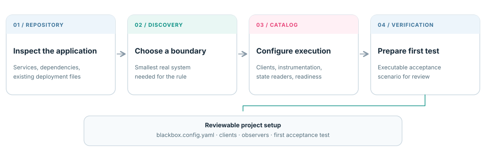
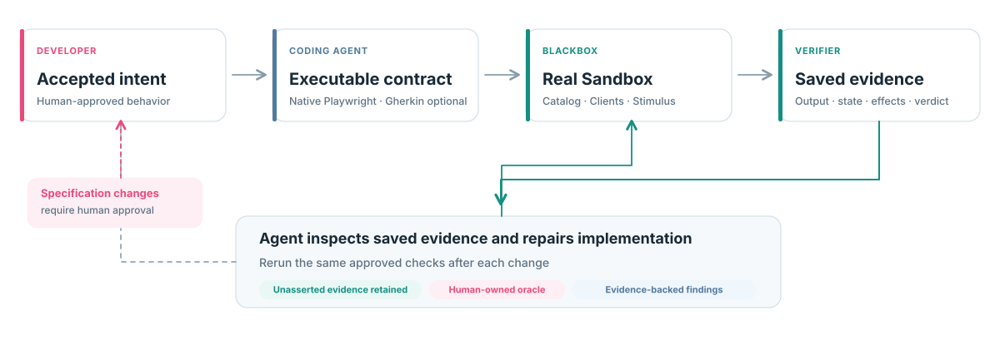

# Suites / Blackbox

**Acceptance testing backed by runtime evidence.**

Blackbox is an open-source TypeScript framework for verifying real applications and systems. Developers approve the behavior that must hold. Coding agents make it executable, run the system in isolated Sandboxes, and inspect the evidence when an implementation fails.

Each stimulus connects the result returned by the system to observed state changes and runtime effects. Named assertions evaluate the accepted contract. Captured observations remain available in the Playwright attempt even when no assertion checks them.

```text
Blackbox attempt 1: Playwright passed; claims verified; evidence available; capture captured
Claims: 4 passed, 0 failed, 0 inconclusive, 0 interrupted
  When Alice submits her payment method: output captured; state initial captured, final captured;
    effects captured (0 initial, 4 latest, coverage partial, open)
  test-results/.../blackbox-report/.../report.html
```

<!-- Replace this real terminal excerpt with a captured terminal image after the alpha packages are published. -->

[Get started](#get-started) · [Acceptance test](#write-the-accepted-scenario) · [Evidence](#inspect-the-run) · [Agent workflow](#work-with-a-coding-agent)

## Get started

Install Blackbox in the application repository. The payment example needs Node.js 22.22.2 or newer, Docker with Compose, and Playwright:

```sh
npm install --save-dev @suites/blackbox@alpha @suites/blackbox-cli@alpha \
  @suites/blackbox-playwright@alpha @suites/blackbox-inst-runtime-node@alpha \
  @playwright/test

npx blackbox onboarding start
```

The onboarding command prints a handoff for a coding agent. The agent uses the installed skills to discover the application boundary and prepare Blackbox. You review the configuration it writes to your repository. [The package-owned payment example](packages/instrumentation-runtime-node/templates/payment-system/README.md) shows a complete Node, PostgreSQL, and Redis system.

<p align="center">
  
</p>

## Write the accepted scenario

Start from a requirement that a developer can approve:

> When Alice submits a valid payment method, the service returns a succeeded payment intent and retains exactly that intent.

The native Playwright test observes PostgreSQL and Redis before and after the request. Its precondition checks the captured initial state before sending the request. The response, state change, and observed HTTP effect are named claims of the same execution:

```ts
import { expect, test } from '@suites/blackbox-playwright';

test.describe('Rule: accepted payments are retained as succeeded intents', () => {
  test('Scenario: Alice submits a valid payment method', async ({ clients, state, stimulus }) => {
    const payments = state.observe('payments', {
      rows: async () =>
        (await clients.postgres.query('SELECT id, status FROM payment_intent ORDER BY id')).rows,
      cachedIntent: () => clients.redis.get('payment-intent:alice'),
    });

    const { result, evidence, verify } = await stimulus(
      'When Alice submits her payment method',
      ({ request, headers }) =>
        request.post('/v1/payment_intents', {
          headers,
          data: { userId: 'alice', paymentMethodId: 'pm_alice_primary' },
        }),
      {
        precondition: {
          name: 'Given no payment intents exist',
          check: ({ initial }) => expect(initial(payments).rows).toEqual([]),
        },
      },
    );

    const intent = await verify('Then a succeeded intent is returned', async () => {
      expect(result.status()).toBe(201);
      const body = await result.json();
      expect(body.status).toBe('succeeded');
      return body;
    });

    const { final, diff } = evidence.state(payments);
    await verify('And exactly that payment is persisted', () => {
      expect(diff.rows.added).toEqual([intent]);
      expect(final.rows).toEqual([intent]);
    });

    const effects = evidence.effects;
    if (effects === undefined) throw new Error('Stimulus effects are unavailable');
    await verify('And the payment request is observed at runtime', async () => {
      await expect(effects.http({ actor: 'payment-api', method: 'POST' })).toHaveEmitted();
    });
  });
});
```

This excerpt uses the system and typed clients registered in [the Playwright configuration](e2e/playwright-payment.config.ts). The [complete acceptance test](e2e/tests/playwright-payment/payment-intents.spec.ts) also compares normalized final state with a reviewed snapshot. You can select a system in a test file with `test.use({ blackbox: { system: 'payment-system', clients } })` instead of the config-level selection.

The request span is an explicit claim in this example. An interaction that is merely recorded does not become an accepted requirement on its own. A positive effect assertion can pass when an occurrence is observed; an absence or exact-count claim needs sufficient coverage and can be inconclusive when the observation window is open.

## Inspect the run

Run the accepted test with Playwright:

```sh
npx playwright test
```

Every physical attempt gets a fresh Sandbox. Blackbox retains its execution attachment, state checkpoints and diff, effects cuts, capture health, and named claim outcomes. The configured Blackbox reporter writes `report.json` and `report.html` under Playwright's output directory and attaches both to the native result. The terminal prints the report path.

The report distinguishes a passed Playwright attempt, verified claims, and available evidence. It shows later effects cuts separately from the initial cut. In the payment run above, the initial cut observed zero effects while telemetry was still arriving; a later assertion cut observed four. Its coverage stayed **partial and open**, so the report does not treat the initial zero as proof of absence.

Reviewed snapshots are expectations committed with the test. Actual observations remain separate in each run. The payment example normalizes the generated intent ID before comparing its final state with a text snapshot. Structured normalization policies and automatic output/state/effects baselines are not required by this acceptance test.

## Work with a coding agent

Give the agent a requirement and the repository. It can inspect the application, select the smallest real system that demonstrates the behavior, configure the Catalog and clients, then prepare an acceptance test for your review. Approve the expected behavior and the observation bindings before relying on its verdict.

After the agent implements the feature, run the same contract. In the [payment journey](demo/support/playwright-payment.mjs), removing only the PostgreSQL insert leaves the response at HTTP 201 but fails the persistence claim. Restoring the insert passes the unchanged test and snapshot. The agent can use the retained report to investigate and rerun without rewriting the accepted expectation to match a defective implementation.

<p align="center">
  
</p>

Optional Gherkin Feature files can generate native Playwright suites for teams that want them. Native TypeScript tests are sufficient for the workflow above. Playwright can also drive a browser; browser URLs must be resolved against the selected Sandbox entrypoint when the scenario crosses from UI to backend.

[Playwright API and effects matchers](packages/playwright/README.md) · [Payment example](packages/instrumentation-runtime-node/templates/payment-system/README.md) · [Contributing](CONTRIBUTING.md) · [Security](SECURITY.md)

Apache-2.0. See [LICENSE](LICENSE).
