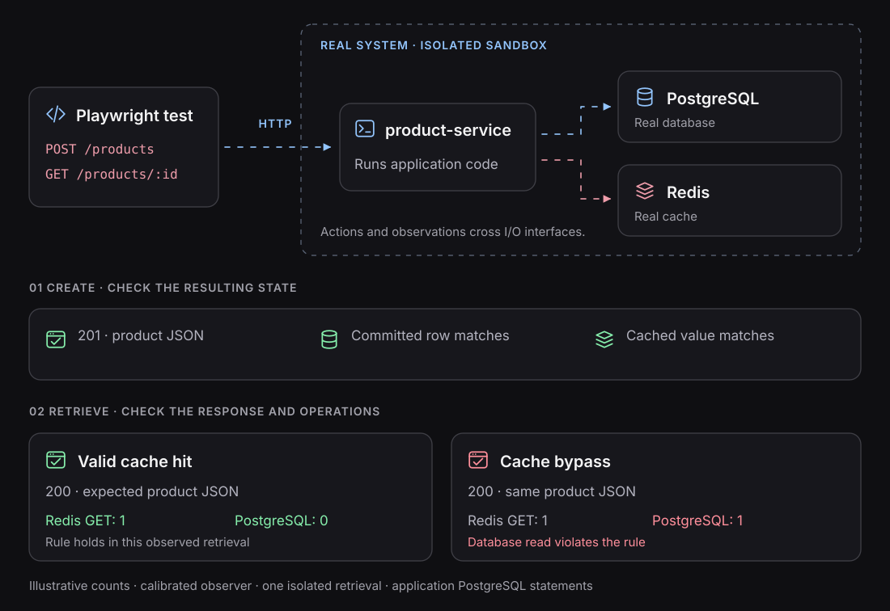
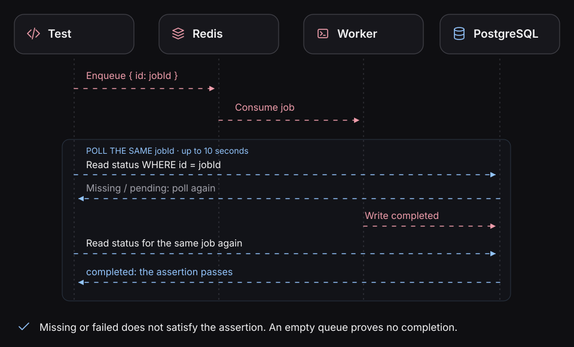

# Check the behavior the specification requires

An HTTP `200` is an observation, not an answer to every requirement. Testing needs a way to decide
whether the observed result is correct: the _test oracle problem_. When agents implement and test
more of the software, reviewed expectations and trustworthy observations make that decision
repeatable rather than relying on an agent's confidence.

[The Oracle Problem in Software Testing: A Survey](https://ieeexplore.ieee.org/document/6963470).

## Observe the running system through its boundaries

Blackbox enters through I/O and inspects outputs, stored state and required interactions. Asserting
that `CacheService.find()` was called couples a test to a method. Checking that a valid cached
retrieval avoided PostgreSQL checks an interaction explicitly constrained by the specification.

The proposed snapshot model keeps that separation: **raw observations are evidence; reviewed output,
state and effects expectations form the contract**. Diagnostic spans need not become assertions.
[Behavioral contracts](../contracts/README.md).

## The same response, different behavior



| What we inspect | Question it answers |
| --- | --- |
| **Output** — status, payload, process result | What did the caller receive? |
| **State** — PostgreSQL row, Redis value | What was stored or changed? |
| **Runtime interactions** — observed SQL, cache, HTTP or messaging operations | What did the application do during the action? |

Choose the observations the requirement needs. A recorded `INSERT` may roll back; a separate state
read can establish visibility of a committed row. A Redis value does not show that the application
used it for a particular retrieval. Publication does not establish consumer completion.

## The outcome depends on how the system is entered

HTTP exposes a response. A CLI exposes exit status and output. A queue consumer may expose a handler
result, acknowledgment or offset commit, depending on the broker. A job may expose completion status.
**There is no universal queue equivalent of an HTTP response.** Submission, processing, settlement,
and downstream business completion may be different events.

These describe how to choose evidence, not a promise of built-in adapters for every entrypoint.
The documented product example exercises HTTP.

## Why absence is harder than presence

The cache rule forbids PostgreSQL access on a valid cache hit. A missing SQL span is insufficient:
an uninstrumented process or incomplete capture can also produce no spans.

The current [cache example](../guides/testing-redis.md#observe-the-retrieval-within-a-bounded-window)
first checks that a known database read is detected, establishes cached state, and then measures
one retrieval through application-role SQL and Redis counters in an isolated window.

```text
Expected valid cache hit:  Redis GET 1 | PostgreSQL statements 0
Deliberate cache bypass:   Redis GET 1 | PostgreSQL statements 1
```

These are expected example values, not a fresh test receipt. Their meaning depends on calibration,
role filtering and exclusion of unrelated traffic. The example uses explicit assertions today;
**do not replace them with an empty effects snapshot** without equivalent coverage guarantees.

## Wait until the behavior is actually complete

A response or queue acknowledgment may precede background work. Check the business completion
condition and deadline specified by the requirement; do not add polling to weaken an immediate
completion promise.



Same-Sandbox membership or overlapping timestamps do not prove one action caused another. Preserve
identity, observation scope, causal limitations and partial capture. [Async guide](../guides/testing-async-flows.md).

## From evidence to an accepted effects baseline

The planned workflow selects relevant runtime interactions, normalizes unstable details, and
proposes a snapshot for review. **OpenTelemetry is an observation source, not the snapshot format
or the acceptance decision.** Exact projection and matching semantics remain to be implemented.

An accepted snapshot does not prove the run was adequately observed. Fresh comparison must still
account for scope, completion and instrumentation compatibility.
[Effects snapshots](../contracts/effects-snapshots.md).

## Read the result without overstating it

A run may support one expectation while leaving another unchecked after an earlier failure.
Supported, refuted and unresolved describe how to reason about evidence; they are not a universal
three-valued API shipped by this alpha. Current assertions use Playwright's actual outcomes.

[Reports](../guides/reports.md) · [Review differences](../contracts/reviewing-changes.md) ·
[Why verification now](why-verification-now.md)
