# Effects snapshots

**Planned capability.** This guide defines the intended workflow, not a released YAML schema,
matcher, command, or automatic recorder. The implementation belongs to a separate PR.

An effects snapshot is a **reviewable expectation about the runtime interactions of a scenario**.
It complements output and state assertions; it does not replace them.

For example, both versions of a cached-product endpoint may return the right JSON. A comparison
could reveal that the new version also queried PostgreSQL, violating the accepted cache rule.


The current product-cache example already checks this with calibrated, sample-owned counters.
It does **not** use an effects snapshot. Keep those assertions until the new observer can establish
the same scope and absence guarantee.

## Raw telemetry is not the expected contract

```text
OpenTelemetry observations
        ↓  select relevant interactions; normalize unstable details
Candidate effects snapshot
        ↓  review against the accepted specification
Accepted effects baseline
        ↓  compare with a new, comparable execution
Differences + observation limitations
```

A trace can help explain a failure without every span becoming an assertion. An accepted snapshot
must preserve relevant behavior, not private function names or incidental implementation structure.
An observed database statement does not establish commit; an outgoing payment request does not
establish settlement. Keep the response and authoritative state checks the requirement needs.

## Capture, propose, accept, compare

<picture>
  <source media="(max-width: 640px)" srcset="../assets/contracts/snapshot-review-mobile.svg" />
  
</picture>

Capture-by-default with explicit opt-out is under consideration. That is separate from approval:
**first capture is not first acceptance**. A normal verification run should compare, not rewrite its
expected file. A missing baseline is not an established match.

Before accepting a candidate, check that its run used the right initial state, stimulus, system
boundary, and completed observation window. Compare it with the spec, not just with the fact that
the application returned success. Then confirm the accepted expectation in a fresh run.

## Keep the comparison meaningful

The implementation needs explicit rules for these cases before users can trust comparisons:

| Concern | Required distinction |
| --- | --- |
| Scenario and action identity | Which test, parameterized case, and stimulus does this expectation describe? |
| Variable values | Ignore unstable values without losing meaningful relationships such as the same payment ID across effects. |
| Ordering and retries | Preserve required causal/order constraints; do not invent one universal total order for concurrent work. |
| Scope | Exclude setup/inspection traffic where appropriate without dropping application behavior that matters. |
| Observation availability | Missing or partial telemetry is not an empty behavioral result. |
| Observer changes | An instrumentation or normalization change is not automatically a product regression. |
| Sensitive data | Do not commit credentials or private payloads from recorded runs. |

These are **comparison requirements**, not implemented YAML fields. A file's sibling name is not
enough to associate all scenarios and physical attempts reliably.

In particular, a negative requirement such as “no PostgreSQL read” needs adequate observation
coverage and completion. A baseline with no SQL effects cannot provide that guarantee by itself.
[Absence evidence](../concepts/behavioral-evidence.md#why-absence-is-harder-than-presence).

## Review changes rather than recording success

An added interaction may be a bug, a deliberate requirement change, or a change in what the observer
can see. Investigate before updating. Changes to selection, normalization, or opt-out policy can
weaken the check just as changing a TypeScript assertion can.

[Reviewing changes](reviewing-changes.md) · [CI verification](../guides/ci-verification.md) ·
[Reports](../guides/reports.md)
