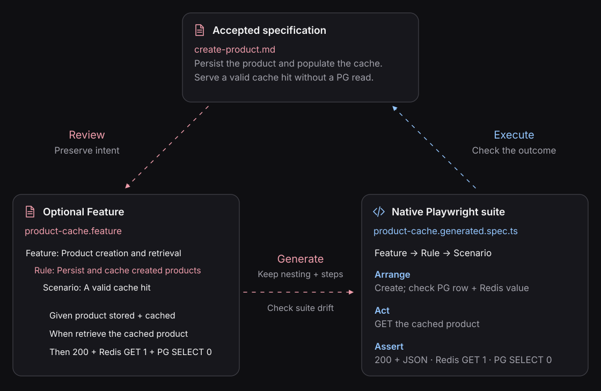

# Keep reviewed behavior in the suite you execute

A compiled suite is derived output. An accepted effects baseline is a runtime expectation. They
are separate artifacts with **different drift checks**.



This guide uses the candidate product-cache workspace after the merged PR #181 APIs and sample are
available. All commands below run from `e2e/product-cache/`.

## Don't confuse generated suites with editable scaffolds

The Feature compiler emits a complete deterministic suite for supported steps. Do not hand-edit it,
including to add hypothetical snapshot calls. A future effects binding must be supported explicitly
by the compiler/runtime.

A native suite is project-owned TypeScript. The separate [editable scaffold generator](../playwright/editable-scaffolds.md)
is planned and has no byte-level generation guarantee. Both routes can participate in the proposed
[behavioral contract](../contracts/README.md), including accepted effects when implemented.

## Check for drift

```sh
pnpm exec blackbox feature suite validate tests/product-cache.feature \
  --clients tests/clients.ts --output tests/product-cache.generated.spec.ts
```

The candidate compiler regenerates in memory and compares bytes. It writes nothing and does not
run the system. Generated formatting matters; keep the output outside automatic formatting.
This command cannot say whether the source spec was complete or an effects baseline matched a run.

## Review a change before replacing the suite

For practice, change the cached-retrieval Scenario title to include `while the cache entry is valid`,
without changing requests or assertions. Validation should report `Generated suite has drifted`.
For a change in intended behavior, review the specification and its consequences first.

## Generate a candidate, then execute it

Choose an unused candidate path; emission refuses to overwrite an existing file:

```sh
pnpm exec blackbox feature suite emit tests/product-cache.feature \
  --clients tests/clients.ts --output tests/product-cache.candidate.ts
```

Inspect the candidate. For a title-only change, expect the same scenarios, setup, hierarchy and
assertions. After accepting the generated change:

```sh
mv tests/product-cache.candidate.ts tests/product-cache.generated.spec.ts
pnpm exec tsc --project tsconfig.json
pnpm exec blackbox feature suite validate tests/product-cache.feature \
  --clients tests/clients.ts --output tests/product-cache.generated.spec.ts
pnpm --dir .. exec playwright test --config product-cache/playwright.config.ts --project feature --list
pnpm --dir .. exec playwright test --config product-cache/playwright.config.ts --project feature
```

Confirm that both scenarios were discovered and executed. Generating code successfully does not
establish runtime correctness.

## Repeat the same checks in CI

**Feature drift** compares reviewed source with generated TypeScript. **Effects differences**, when
snapshot comparison is implemented, compare fresh runtime observations with an accepted baseline.
Normal CI should compare both applicable relationships without approving new expectations.

A missing baseline or unavailable observation is not a match. A deliberate behavior change needs
review of the source requirement, tests and baseline together. Existing output/state assertions
remain necessary; snapshot support does not replace them.

[CI verification](../guides/ci-verification.md) · [Baseline review](../contracts/reviewing-changes.md) ·
[Repair without changing expectations](../guides/repair-from-evidence.md)
