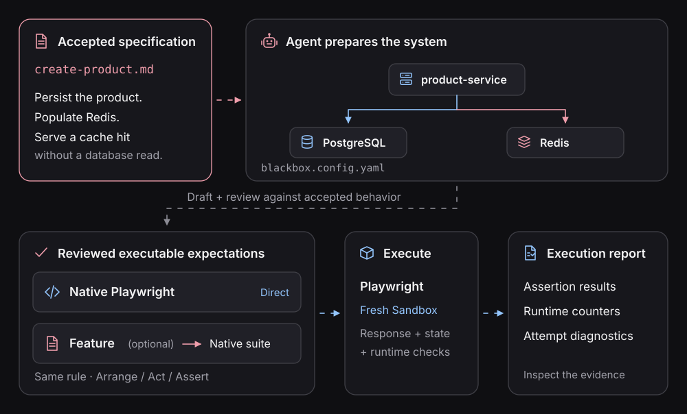

# Follow one behavior into repeatable verification

The first task is concrete: **verify this accepted requirement against the running application**.
The result should be a reusable check, not just a successful setup command.

[The developer workflow](from-spec-to-verification.md) covers review, system discovery, optional
Capsule experiments and fresh Playwright verification. The planned snapshot extension adds candidate
capture and deliberate baseline acceptance to that same workflow.

| Task | Guide |
| --- | --- |
| Follow a complete business rule | [Product-cache verification](verify-a-specification.md) |
| Prepare your own repository | [Agent setup](../playwright/connect-your-application.md) |
| Investigate an uncertain result | [Capsule experiments](investigate-with-capsule.md) |
| Inspect execution evidence | [Reports](reports.md) |
| Repair a meaningful regression | [Cache-bypass exercise](repair-from-evidence.md) |
| Preserve the accepted baseline | [Review changes](../contracts/reviewing-changes.md) |
| Repeat checks in CI | [CI verification](ci-verification.md) |

## Choose evidence for the claim

[HTTP](testing-http-apis.md), [PostgreSQL](testing-postgres.md), [Redis](testing-redis.md), and
[async completion](testing-async-flows.md) explain different observation needs. They are not three
mandatory assertion categories. The spec determines what must be established.

The current product sample uses explicit output, state and operation assertions. The proposed
[effects snapshot](../contracts/effects-snapshots.md) must preserve equivalent observation guarantees
before replacing any of those checks. A separate state YAML is not part of the current workflow.

## Extend an accepted requirement

Reuse suitable system configuration and observers for more scenarios. Fresh runtime isolation does
not mean duplicating repository setup. Existing native Playwright tests are an intended adoption
path too, but this guide does not define an automatic migration workflow.

[Behavioral contract](../contracts/README.md) · [Native authoring](../playwright/README.md) ·
[Feature authoring](../features/README.md)
