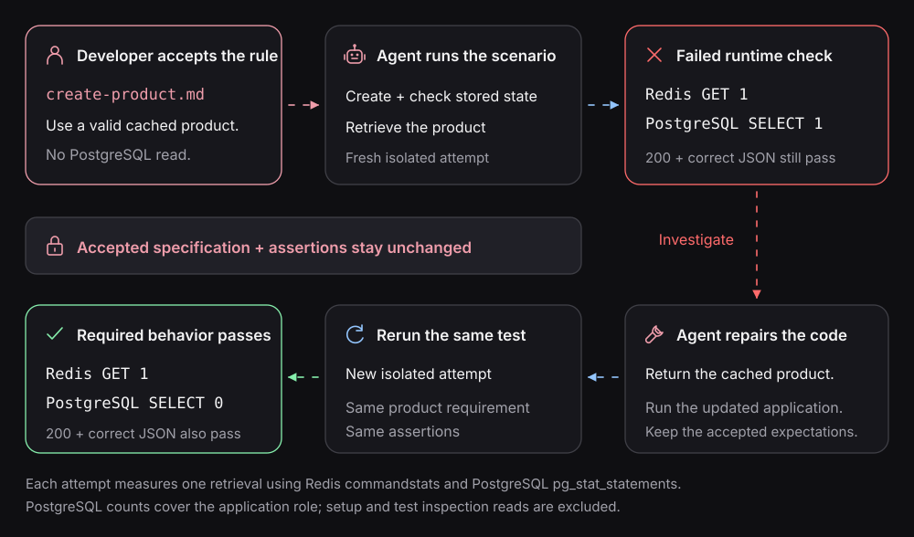

# Case study: repair a cache bypass

A retrieval returns the expected product with `200`, but also reads PostgreSQL
despite a valid cache entry. The response is correct; the accepted interaction
requirement failed.

This exercise continues the [product-cache case study](verify-a-specification.md).
It requires an implemented sample and observer; those files are not supplied in
this checkout. The [first-test tutorial](../getting-started.md#5-see-the-test-detect-a-defect)
provides an executable, smaller failure exercise.



## Introduce a detectable defect

In a disposable implementation, suppose the retrieval path contains:

```js
if (cached !== null) {
  return JSON.parse(cached);
}
```

Temporarily bypass that return so execution falls through to the database read.
Run the configured retrieval scenario. The correct response should still satisfy
its response assertion; the bounded database observation must reject the read.
If it does not, investigate the observer before relying on the test.

## Keep the accepted rule fixed

Preserve the failed report before rerunning. Give the agent the exact failed
attempt, expected no-read behavior, and the observed database activity. Ask it to
distinguish an implementation defect from incorrect or incomplete observation.

Changing the expected read count to one would hide this defect. A legitimate
requirement change needs [separate review](../contracts/reviewing-changes.md).

## Repair and rerun

Restore the cache-hit return. Repeat the same scenario in a fresh Sandbox with
its own calibration and cached-state preparation. Keep the failed and repaired
attempts separately identifiable.

For native tests, execute the authored suite. For a candidate generated Feature
suite, validate its alignment with the Feature before running it. Generation
validation does not establish that the runtime observation passed.

[Read reports](reports.md) · [Cache observation design](testing-redis.md) ·
[CI verification](ci-verification.md)
