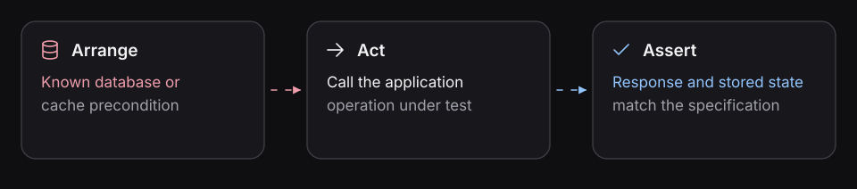

# Express accepted behavior in native Playwright

Native tests exercise a **running system through I/O**. SDK clients send requests and inspect the
state or interactions required by the specification. The application runs its implementation; the
test does not import business classes to invoke them.

This is a first-class authoring path. A new Markdown spec or Gherkin file is not mandatory for every
test. Existing Playwright system tests are an intended adoption path too; the setup and migration
workflow is not yet defined, and unchanged compatibility is not promised.

## Start from the claim, not the SDK

A successful response, a saved row, and a forbidden database read are different questions. Write
assertions against the observations that can answer each one. A Capsule can establish useful actions
and observers when they are unknown; a known system can go directly to Playwright.

[Evidence model](../concepts/behavioral-evidence.md) · [Capsule investigation](../guides/investigate-with-capsule.md).

## Keep the rule visible in the test



The [candidate native suite](../guides/verify-a-specification.md#native-playwright) preserves
Feature/Rule/Scenario names and Arrange/Act/Assert phases. Creation checks the response and stored
PostgreSQL/Redis values. Cached retrieval establishes its own preconditions, calibrates its observer,
and checks that the application's bounded retrieval did not access PostgreSQL.

Each scenario owns a fresh Sandbox. It cannot borrow a product, observer window, or evidence from a
previous test or Capsule. The sample-owned `/fixture/` endpoints inspect real resources; they are
not built-in Blackbox APIs. Direct PostgreSQL and Redis clients are also valid observation tools.

## The test is part of the behavioral contract

The proposed sibling layout is:

```text
create-payment.blackbox.test.ts    project-owned actions and assertions
create-payment.feature            optional reviewed scenarios
create-payment.effects.yaml       planned accepted effects baseline
```

The names illustrate the design, not automatic discovery. Output and state assertions remain in the
suite. A separate `.state.yaml` file is undecided. An accepted effects baseline would complement
those assertions, not replace state reads or become a dump of all raw spans.

**Generated and authored code remain different.** A Feature compiler's output must not be edited;
a native test is project-owned. The [editable scaffold generator](editable-scaffolds.md) is planned,
and incomplete scaffold checks must fail visibly. Both routes can participate in the future snapshot
model, but this PR adds no capture API, matcher or automatic file loading.

[Behavioral contract](../contracts/README.md) · [Snapshot design](../contracts/effects-snapshots.md).

## Separate connection setup from behavior

`defineClient` binds a project's SDK to the selected participant and mapped endpoint. The sample
registers its authenticated API client in `system.sandbox(...)` and calls `clients.api` normally.
`test.system(...)` selects the Catalog boundary; `suite.describe` and `suite.test` retain behavior
names; the injected `step` fixture names runtime steps and maintains attempt context.

Blackbox readies and disposes clients. The application owns its schema, authentication, fixtures and
observation meaning. Registering an SDK does not automatically instrument it or propagate context.
[Client and fixture reference](clients-and-fixtures.md).

Reuse suitable configuration and observers for additional scenarios. Fresh runtime isolation does
not require a separate infrastructure stack in the repository for every specification.

## Run the same reviewed expectations

After the [candidate example prerequisites](../guides/verify-a-specification.md#run-the-supplied-example),
from `e2e/product-cache/`:

```sh
pnpm --dir .. exec playwright test --config product-cache/playwright.config.ts --project native --list
pnpm --dir .. exec playwright test --config product-cache/playwright.config.ts --project native
```

Confirm both scenarios actually ran. Keep setup failures, skipped assertions, retries, and cleanup
outcomes visible. The planned effects comparison must also preserve unavailable observation as a
limitation rather than an empty match. [Reports](../guides/reports.md).

## Ask the agent to add another scenario

```text
Add a test for this accepted behavior using the existing system setup when suitable.
Establish its own initial state and check the required output, state, and interactions.
Keep expected behavior fixed while repairing code or test support.
If snapshot support is available, propose effects for review instead of auto-accepting them.
Run the focused scenario and report anything it did not establish.
```

[Repair exercise](../guides/repair-from-evidence.md) · [CI verification](../guides/ci-verification.md)
